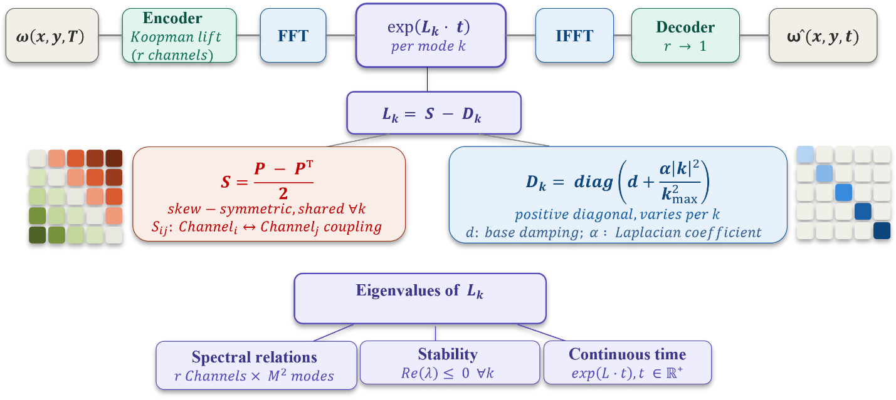
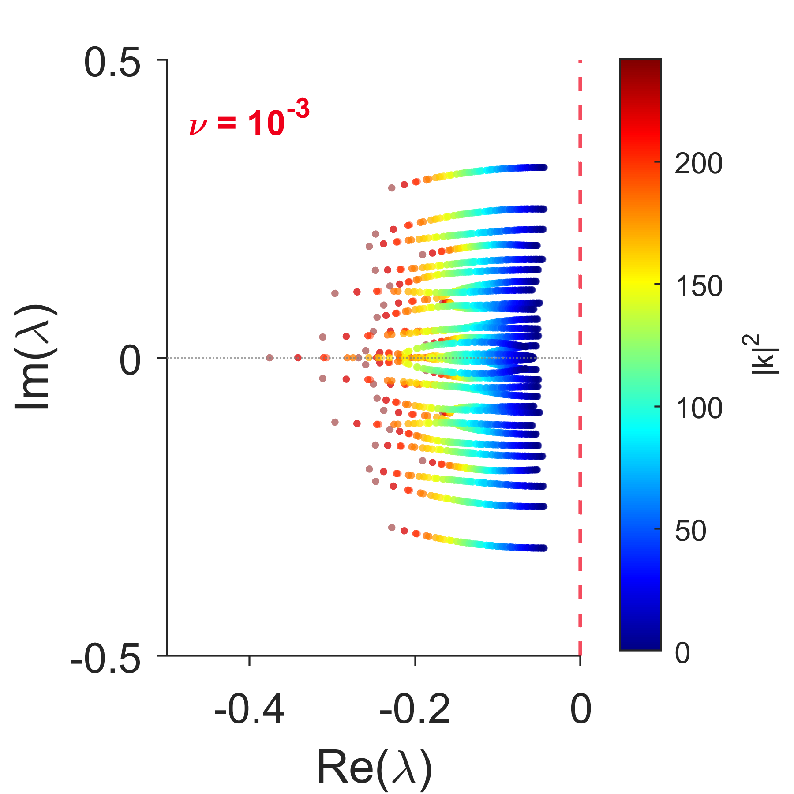
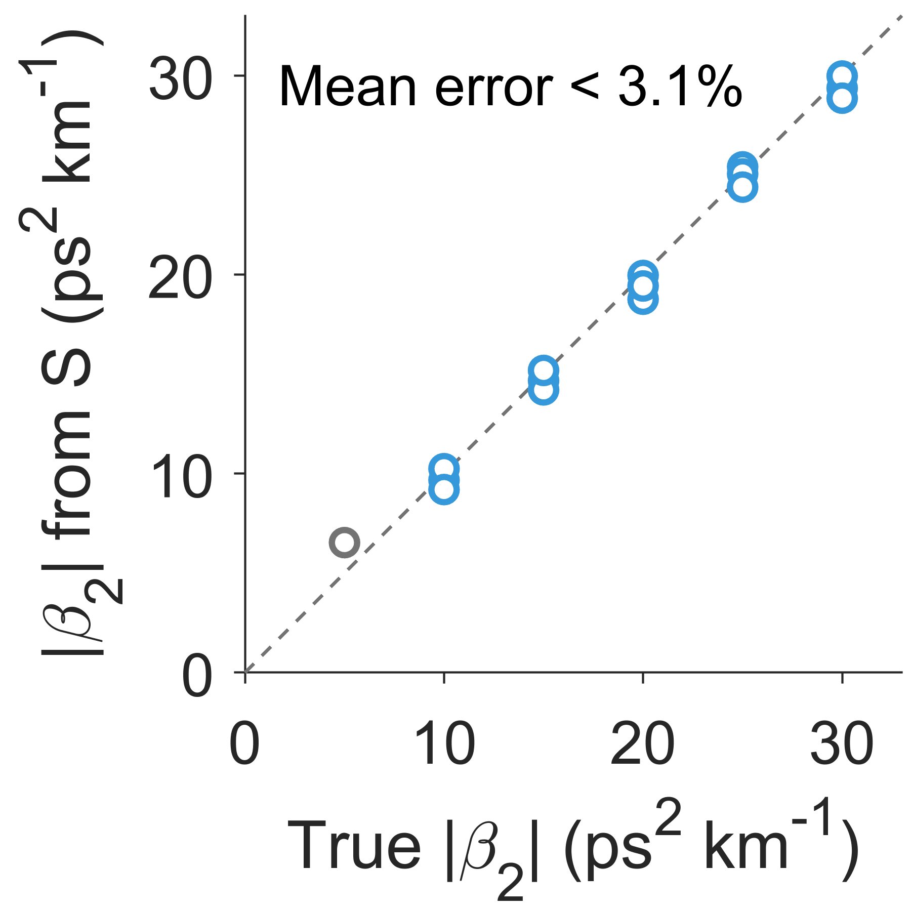
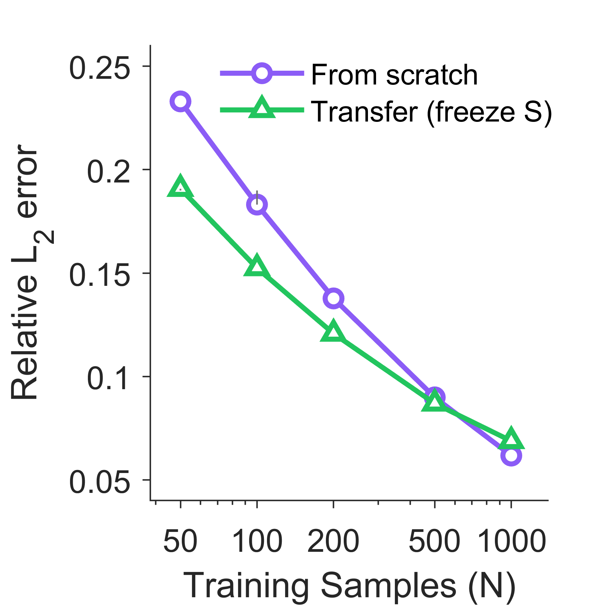

# LGN-KM: Linear Generator Network–Koopman

**Eigenvalues for nonlinear PDEs.** LGN-KM is a neural operator that learns the continuous-time *generator* of a nonlinear PDE's dynamics, in a structured form you can read directly. Decay rates, oscillation frequencies and dispersion relations come straight out of the trained weights, and stability is guaranteed by construction.

> S. Jamil and R. Kapadia, *Linear Generator Networks for Nonlinear Partial Differential Equations*, **NeurIPS 2026**.

<p align="center"></p>

## The Main idea

Linear systems are transparent: their generator's eigenvalues tell you how every mode decays and oscillates. Nonlinear PDEs have no such generator, but the Koopman view says the dynamics become linear in the right lifted coordinates. LGN-KM learns that lift with a neural encoder. In the lifted space, at every Fourier mode k, it learns the generator in the form

**L_k = S − D_k**

- **S is skew-symmetric** and shared across modes. It is the conservative coupling, and it only rotates.
- **D_k is a positive diagonal** that grows with |k|². It is mode-selective damping.

So every eigenvalue has Re(λ) ≤ 0 by construction, the whole spectrum is legible from about 560 parameters, and the state at any time t is a single matrix exponential exp(L_k t). There is no step-by-step rollout.

## What you get

- **A spectrum for 2D turbulence.** On Navier–Stokes, the generator gives a complete multi-branch dispersion relation: 4,608 eigenvalues, all stable. Small scales decay faster, as viscosity demands. A learnable dissipation exponent, initialized at 1, rises to 2.2–2.4.
- **Physics you can check against a known answer.** On optical-fiber pulse propagation (the nonlinear Schrödinger equation), the rotation rates of S trace the fiber's dispersion relation. The fastest one gives the group-velocity dispersion to within 3.1%, with **no fitted constant**: |β₂| = 2 f_max / (Ω₁₅² Δz).
- **Structure shared across regimes.** Models trained independently at viscosities 100× apart learn the same singular-value profile of S (R² = 0.87).
- **Stable, any-time prediction.**
  - Rollouts stay bounded to t = 200, where FNO and LRAN diverge.
  - Querying t = 200 costs 1.9 ms, against 299 ms for FNO's 200 autoregressive steps.
  - Queries between training frames beat interpolating the model's own frames at every time.
- **Transfer with little data.** Freezing S from the ν = 10⁻⁵ model and fine-tuning the rest at ν = 10⁻³ gives 18% lower error than training from scratch with 50 trajectories.
- **Beyond Navier–Stokes.** The same architecture, unchanged, works on FitzHugh–Nagumo reaction–diffusion, including no-flux boundaries via a cosine lift.

<p align="center">



</p>
<p align="center"><sub>Left: all 4,608 eigenvalues of the learned generator for 2D Navier–Stokes (ν = 10⁻³), coloured by |k|²; every one sits left of the imaginary axis. Middle: fiber dispersion |β₂| read from the rotation rates of S vs the true value, mean error under 3.1% with no fitted constant. Right: transfer from ν = 10⁻⁵ to ν = 10⁻³ with S frozen beats training from scratch at every data budget up to 500 trajectories.</sub></p>

## Try it in a minute

```bash
git clone https://github.com/ShafayethJamil/Linear-Generator-Network-Koopman.git
cd Linear-Generator-Network-Koopman
pip install -r requirements.txt
bash scripts/download_checkpoints.sh     # all trained models, ~285 MB
python examples/read_generator.py        # no data needed
```

```
Navier-Stokes nu=1e-5: 4608 eigenvalues, Re in [-1.76, -0.0211] (all stable), Im in +/-0.70
Navier-Stokes nu=1e-3: 4608 eigenvalues, Re in [-0.38, -0.0444] (all stable), Im in +/-0.32
Fiber with |beta2| = 10 ps^2/km: read from the generator 10.2 ps^2/km
Fiber with |beta2| = 20 ps^2/km: read from the generator 18.8 ps^2/km
Fiber with |beta2| = 30 ps^2/km: read from the generator 30.0 ps^2/km
```

The whole readout is in `examples/read_generator.py`: the generator lives in three tensors of the checkpoint (`P`, `d`, `alpha`).

## Train your own

```bash
# 2D Navier-Stokes (Li et al. benchmark; download link in data/README.md), ~40 min on one GPU
python navier_stokes/train_lgnkm.py --data data/ns/NavierStokes_V1e-5_N1200_T20.mat --T_out 10 --tag nu1e5

# optical fiber: generate pulses, train on the complex field, read beta2
python nlse/datagen.py --regime soliton --beta2_list -20 --save_dir data/nlse
python nlse/train_nlse.py --data data/nlse/nlse_b2_20_soliton.mat --field complex --tag b2_20 --save_dir outputs/nlse
python nlse/readout.py --ckpt outputs/nlse/final_koopman_nlse_b2_20.pt --data data/nlse/nlse_b2_20_soliton.mat --beta2 -20
```

## Every experiment in the paper

Each script's docstring has the exact command for its paper result. The checkpoints are in the release and are fetched by `scripts/download_checkpoints.sh`.

| Paper | Code | Checkpoints |
|---|---|---|
| §3.1–3.2, Figs 2–3, Navier–Stokes generator and cross-regime structure | `navier_stokes/train_lgnkm.py`, `extract_SD.py` | `ns/` |
| §3.2, Table A.3, A.6, learnable exponent, free diagonal | `navier_stokes/dissipation/` | `dissipation/` |
| §3.3, Fig 4, A.8, optical-fiber dispersion | `nlse/` | `nlse/` |
| Table 1, FNO, DMD, LRAN and KNO baselines | `navier_stokes/train_fno.py`, `baselines/` | `ns/`, `baselines/` |
| §4.1, Fig 5, long horizon and timing | `long_horizon/`, `continuous_time/` | `ns/`, `baselines/` |
| A.9, long-horizon accuracy and unseen time resolution | `long_horizon/run_pipeline.sh` | `ns/`, `baselines/` |
| §4.2, Fig 6, A.3, cross-viscosity transfer | `transfer/` | `transfer/` |
| A.2, A.5, A.10, channel dimension, structural ablations, sensitivity | `navier_stokes/ablations/` | `ns_ablations/` |
| A.4, A.7, FitzHugh–Nagumo, periodic and no-flux | `fitzhugh_nagumo/` | `fhn/` |

Result tables from the paper's runs sit next to the code, in `baselines/results/`, `long_horizon/results/`, `transfer/results/` and `navier_stokes/dissipation/results/`.

To recompute the paper's reported numbers from the released checkpoints, run `python verify/verify.py`. It takes a few seconds; add `--data_dir data/ns` to also re-evaluate test errors.

## Citation

```bibtex
@inproceedings{jamil2026lgnkm,
  title     = {Linear Generator Networks for Nonlinear Partial Differential Equations},
  author    = {Jamil, Shafayeth and Kapadia, Rehan},
  booktitle = {Advances in Neural Information Processing Systems (NeurIPS)},
  year      = {2026}
}
```

MIT license.
